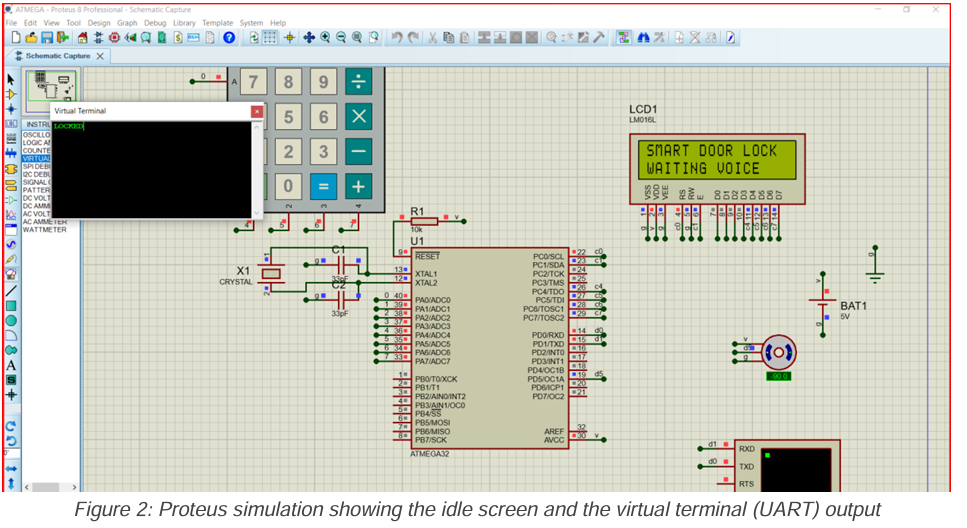
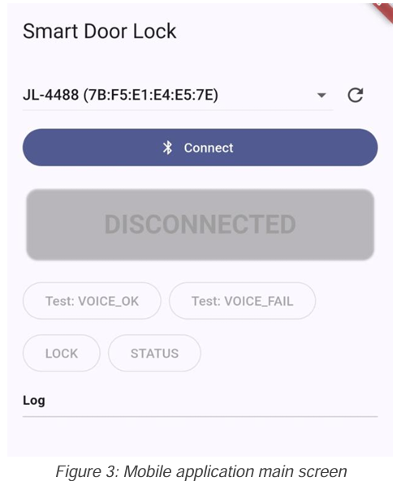

# Smart Door Lock (ATmega32A)

A door lock controlled by a 4x4 keypad, a voice-verification result sent from a phone app over Bluetooth (UART), and a servo motor that acts as the lock. Status is shown on a 16x2 LCD and sent back over UART.

**Demo video:** [Watch the hardware demo](Video/smart-door-lock.mp4)

## Repository content

| Path | Description |
|------|-------------|
| `main.c` | Original source: LCD in 4-bit parallel mode, 8 MHz external crystal (tested in Proteus) |
| `main_i2c.c` | Modified source for a 4-wire I2C LCD (VCC, GND, SDA, SCL). Clock set by `F_CPU` (default 8 MHz) |
| `mainnew.hex` | Prebuilt firmware of `main_i2c.c` for a **20 MHz** clock |
| `.github/workflows/build.yml` | Builds `main_i2c.c` automatically (8 MHz and 20 MHz). Download the `.hex` from the Actions tab |
| `Pictures/` | Proteus simulation and mobile app screenshots |
| `Video/smart-door-lock.mp4` | Hardware demo video |

## Hardware

- ATmega32A, 2 x 33 pF capacitors with the crystal
- 16x2 LCD (parallel in the original version, I2C backpack in the modified one)
- 4x4 matrix keypad
- SG90 servo motor
- HC-05 Bluetooth module (UART), with a phone app that sends the voice result

## Pin connections

| Peripheral | ATmega32A pin |
|------------|---------------|
| Keypad rows | PA0 - PA3 |
| Keypad columns | PA4 - PA7 |
| Servo signal | PD5 / OC1A (pin 19) |
| UART RXD / TXD | PD0 / PD1 (9600 baud, 8N1) |
| LCD, original version | RS = PC0, E = PC1, D4 - D7 = PC4 - PC7 |
| LCD, I2C version | SCL = PC0 (pin 22), SDA = PC1 (pin 23) |

## How it works

1. The system starts locked and the LCD shows `SMART DOOR LOCK / WAITING VOICE`.
2. A `VOICE_OK` message arrives over UART from the phone app and the system asks for the PIN.
3. The user types the PIN and presses `#` to confirm. `*` clears the input.
4. A correct PIN moves the servo to 90 degrees (unlocked). The door locks again automatically after 10 seconds.
5. After 5 wrong PINs the system locks out for 30 seconds.
6. While unlocked, key `A` changes the PIN (4 to 6 digits, stored in EEPROM). The default PIN is `1234`.

| UART command | Action |
|--------------|--------|
| `VOICE_OK` | Voice verified, ask for PIN |
| `VOICE_FAIL` | Voice failed |
| `LOCK` | Lock the door immediately |
| `STATUS` | Reply with the current state |

Replies: `LOCKED`, `WAITING_PIN`, `UNLOCKED`, `CHANGING_PIN`, `ACCESS_DENIED`, `PIN_CHANGED`.

## Build

```
avr-gcc -mmcu=atmega32a -Os -DF_CPU=8000000UL main_i2c.c -o main_i2c.elf
avr-objcopy -O ihex -R .eeprom main_i2c.elf main_i2c.hex
```

Optimisation `-Os` is required. The GitHub Actions workflow does this automatically.

## Fuses

Check with a fuse calculator before writing.

```
External 8 MHz crystal:     lfuse = 0xFF   hfuse = 0xC9
Internal 8 MHz oscillator:  lfuse = 0xE4   hfuse = 0xC9
```

The ATmega32A is rated for 16 MHz, so a 20 MHz clock is out of spec.

## Screenshots




